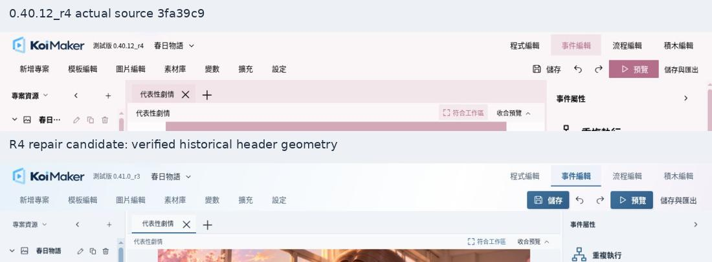

# Koi Maker 0.41.0_r4 候選修復驗收紀錄

> 本檔為發布前的 R1–R6 快照。R7 已在 2026-10-24 完成；最新實測、限制與 Sites 65 正式發布資料請見 `FINAL-QA.md` 及 `DEPLOYMENT.json`。

日期：2026-10-24（台灣）。狀態：**尚未發布，不可標記正式 r4 完成**。

本輪接續最新 r3；R1–R5 已提交，R6 保留實測與尚未通過的發布門檻。R7 未執行。所有截圖中的製作器版號仍為 r3，是因為依任務 R7 規定，須通過全部發布門檻後才能更新正式版號；截圖內容是 r4 分支的修復程式。

## 來源與回復點

| 項目 | 實際值 |
| --- | --- |
| 原 Sites 專案 | appgprj_6ad04b4f4db081918fe4a0e9d541130f |
| 正式站 | https://koimaker.briny-angel-8862.chatgpt.site |
| 目前正式版 | 0.41.0_r3，Sites 64 |
| 正式發布來源 | f2db20232f5349b2907c3836fdcf549e8c9b81ae |
| R1 遠端與本機接續 HEAD | 3f9d5d7a98c140c0107b94a5547ef377da00134a |
| r3 檢查點 | checkpoint-0410-r3-before-r4 |
| r4 分支 | feature/softflow-0.41.0-r4 |
| 真實歷史布局來源 | 0.40.12_r4，3fa39c9a7e8c9f0bb27b26cb5c4c929ad385f4b6 |
| 正式回復版本 ID | appgprj_6ad04b4f4db081918fe4a0e9d541130f~appgver_478d5161f36881918f0d22debfb405b6 |
| 回復部署 ID | appgdep_6adc59dbb85481918952c6c5f4f7a915 |
| r4 正式 Sites 版本／發布來源 | 尚未建立／尚未發布 |
| 最新開發接續 Commit | 見交付的 DEVELOPMENT-MANIFEST.json，並可由完整原始碼 ZIP 的 Git archive 註解確認 |

R1 備份：`Koi-Maker-r3-before-r4-source.zip`（20,051,970 bytes）、`Koi-Maker-r3-before-r4.bundle`（34,833,040 bytes）。SHA-256：

```text
c0a1ee6b9fd4c40bd3dd19e74017508b60a163ecf232ba50e7dc22b62d25f445  Koi-Maker-r3-before-r4-source.zip
5e807fe755e604efba178046f390b41e72c62d68a69d1c2bb43c2dcbba016e03  Koi-Maker-r3-before-r4.bundle
```

正式站回復 archive hash：`sha256:706ce45af6ec88f01590fca3dcab58b44add456f3906eca9e2d2633baedd1d62`。完整來源、回復資訊與資料保護說明見 `R1-SOURCE.json`。

未修改儲存層、遷移規則、專案格式、故事引擎或積木資料模型；未清除使用者資料。測試副本的儲存名稱與正式儲存名稱分離。沒有重新加入「批次修復素材引用」或「預聽和弦」。

## 提交階段

| 階段 | Commit | 內容 |
| --- | --- | --- |
| R1 | ecb06e2 | 核對最新 r3、遠端、完整 ZIP／bundle、正式回復點與七張輸入截圖 |
| R2 | 4d2b6de | 復原歷史頂部，重用專案位置容器 |
| R3 | 42aee41 | 將 screen-tools 從錯誤橫向工具列分離 |
| R4 | 496d079 | 字級、單一鍵盤焦點、單層流程節點選取 |
| R5 | 2181436 | 開場表單分組、原生色票入口、取消與還原 |
| R6 檢查點 | 本檔所在的後續提交 | 補齊資源欄銜接、窄欄重排、回歸測試與證據；保留發布阻擋條件 |
| R7 | 未執行 | 尚未滿足所有真實瀏覽器發布門檻 |

## 頂部歷史比對

從歷史 Git 原始碼建立完整應用程式隔離副本並實際開啟，沒有用舊版程式覆蓋 r3 引擎。以 1366×768、預設字級比較：

| 元件 | 0.40.12_r4：x,y,w,h | r4 候選：x,y,w,h |
| --- | --- | --- |
| 頂部 | 0,0,1366,92 | 0,0,1366,92 |
| Logo | 20,5,146,40 | 20,5,146,40 |
| 四模式 | 956,5,390,40 | 956,5,390,40 |
| 主導航 | 20,50,912,42 | 20,50,912,42 |
| 儲存／復原／重做／預覽／匯出 | 956,50,390,42 | 956,50,390,42 |
| 文件分頁 | 244,92,798,44 | 244,92,828,44 |
| 資源欄 | 0,92,240,644 | 0,92,240,650 |

歷史來源本來就是 50px＋42px 兩列：四模式在右上，主導航在左下，專案操作在右下且自身保持單行。這次按歷史結構恢復，沒有新增工具列。文件分頁左起點與高度相同；寬度隨工作區而定，保留 r3 事件屬性面板寬度。資源欄高度差來自保留的 r3 底部列。

版本號字數不同，所以專案選擇器的絕對 x 會跟隨版本文字寬度改變；Logo 後 12px、版本與專案間 8px 的相對順序及間距已恢復。r3 既有空 project-location 與 runtime 再建一份容器的問題已修正。



原始量測：`evidence/r4-04012-header.json`、`evidence/header-final.json`。左欄收合後文件區 x=0、寬1072px，展開後 x=244；見 `evidence/collapse-results.json`。

## 七張缺陷逐項對照

以下比較使用使用者原始缺陷截圖及相應的候選版範圍裁切。專案內容不是同一份；比較用途是特定 GUI 缺陷，並非故事內容的像素差分。

| 原始截圖 | 根因與修復 | 證據／目前結果 |
| --- | --- | --- |
| 074349 首頁與音效 | 大型表單背景與三欄散排；改為連續表面、限定閱讀寬、兩欄相關欄位、獨立進退場效果與秒數分組 | [01](comparisons/01-opening-forms.jpg)，實際開啟；所有 callback 與設定鍵保留 |
| 074324 色票 | 原生 input 被 padding、白底、邊界重複包裝；統一單一原生色塊入口，新增共用 ColorField 的完成／取消／還原 | [02](comparisons/02-color-entry.jpg)，元件即時變色、取消與還原測試通過；原生視窗實際編輯尚待補 |
| 074319 導航 | r3 位置分配不同；依 3fa39c9 還原原本兩列與四模式右上、連續底線選取 | [03](comparisons/03-navigation.jpg)，頂部幾何一致 |
| 074308 版本文字 | r3 小寬度版本區換行，並有空容器額外間隔；取消錯誤限制並重用原容器 | [04](comparisons/04-version-position.jpg)，版本維持單行 |
| 072411 標籤輸入 | 外側 outline 被父容器裁切，造成上下兩條強調線；焦點改為單一內側 outline，focus 不疊 inset shadow | [05](comparisons/05-tag-focus.jpg)，鍵盤 focus-visible=true、2px、offset=-2px、shadow=none；無偽元素裝飾線 |
| 072240 流程節點 | 2px 外框＋類別裝飾線；改一條適度 1px 邊界，關閉節點本體 before/after，保留 ports 與語意連線 | [06](comparisons/06-flow-selection.jpg)，selected border=1px，outline=none、shadow=none，ports 仍可選取 |
| 072212 讀檔側欄 | 共用 `.screen-tools` 被誤指定 nowrap flex，覆蓋 inspector grid；另有 legacy geometry !important | [07](comparisons/07-load-inspector.jpg)，限定 inspector grid、標籤全列、兩欄按鈕、局部捲動、窄工作區移到畫布下方；25組量測無水平溢出 |

沒有以 overflow:hidden 遮住側欄問題，也沒有縮小字體湊版。畫布縮放邏輯未改。舊 template 幾何優先權只在 editor compatibility 建構階段退役；匯出遊戲 CSS 保持原狀。

## 五級字體

根因為模板屬性與開場表單的固定 px 字級漏接既有 UI scale 轉換；補齊限縮的 editor typography 範圍、共用 tokens、行高與控制高度。遊戲及畫布內文字排除於轉換範圍。

| 選項 | UI 比例 | 讀檔屬性／欄位字級 | 對應行高 |
| --- | --- | --- | --- |
| 超小 | 0.8 | 9.6px | 13.92px |
| 小 | 0.9 | 10.8px | 15.66px |
| 預設 | 1 | 12px | 17.4px |
| 大 | 1.1 | 13.2px | 19.14px |
| 特大 | 1.2 | 14.4px | 20.88px |

每一級均透過實際 UI 按鈕操作並讀取真實 Chromium 計算樣式；在五個寬度重複量測。特大偏好於真實瀏覽器儲存、重載後仍為1.2。三項 r4 修復測試另確認五級設定經四模式切換與 IndexedDB round trip 保存，遊戲 settings 完全不變。

資源樹額外檢查：1366px 特大名稱實際寬58、scrollWidth58；1024px 的210px歷史側欄中，既有專案操作移到名稱下方，名稱仍寬58、scrollWidth58，避免截短或改窄中央畫布。見 `evidence/resource-narrow-final.json` 與對應截圖。

## RWD 與縮放

真實 Chromium 中，以同源 iframe 執行完整應用程式，iframe 的 innerWidth／innerHeight 為下列實際 CSS viewport。這不是實體螢幕驗收，也不是 Chrome 縮放模擬。

| 視窗尺寸 | 字體級數 | 整頁／標籤／頂部控制項水平溢出 | 讀檔屬性配置 |
| --- | --- | --- | --- |
| 2560×1600 | 全5級 | 0 | 畫布1758px＋屬性280px |
| 1920×1080 | 全5級 | 0 | 畫布1118px＋屬性280px |
| 1600×900 | 全5級 | 0 | 畫布814px＋屬性280px |
| 1366×768 | 全5級 | 0 | 畫布610px＋屬性280px |
| 1024×768 | 全5級 | 0 | 單欄598px；屬性移到畫布下方 |

數值為 screen-editor-layout 網格欄寬，畫布實際內容另按固定比例符合 viewport。手機／電腦畫布切換時，讀檔屬性仍為12px；畫布縮放沒有帶著屬性面板縮放。

25組完整原始值：`evidence/final-font-rwd-matrix.json`。1366與1024實際畫面可檢視；較大尺寸現有截圖只包含外層瀏覽器可見範圍，全頁截圖請求逾時，尚未完成整個大視窗的視覺檢查。不可將幾何量測全部等同完整視覺通過。

Chrome 預設環境觀察到 devicePixelRatio=1、visualViewport.scale=1。90%、125%、150% 的實際 Chrome 縮放未完成：DOM 鍵盤操作沒有改變瀏覽器縮放，Chrome 設定頁又遭環境安全限制。沒有嘗試繞過限制，也沒有以 CSS zoom、transform 或字體比例偽裝結果。系統字體縮放同樣未驗證。

## GUI 逐頁視覺表

下列頁面均實際開啟並保存截圖。這張表記錄已看到的畫面與操作，不代表所有尺寸、狀態、拖曳與功能均已完整驗收。

| 頁面 | 畫面檢查與操作 | 截圖 |
| --- | --- | --- |
| 專案首頁 | 已開啟、專案列與返回入口可見，無新增卡片托盤 | evidence/r4-project-home.jpg |
| 事件編輯器 | 原有列表／屬性／場景，輸入文字與Undo／Redo實測 | evidence/r4-event.jpg |
| 流程編輯器 | 單層選取、文字與連接點可見；拖曳／接線未實測 | evidence/r4-flow.jpg |
| 積木編輯器 | 收合場景後實際查看C形積木、欄位、分類與工作區；右鍵單一拆分與Undo實測 | evidence/blocks-final.jpg |
| KOI Script | 實際來源、檔案分頁、檢查完成；沒有從舊版覆蓋模型 | evidence/r4-koi-script.jpg |
| 圖片編輯器 | 真正圖片載入；水平翻轉與局部復原可操作 | evidence/r4-image-editor.jpg |
| 素材庫 | 用途、引用、檔案入口可見；標籤鍵盤焦點單一 | evidence/r4-asset-tag-focus.jpg |
| 模板編輯 | 遊戲畫面編輯與既有控制保留，非假畫布 | evidence/r4-template-editor.jpg |
| 讀檔畫面 | 屬性不再垂直堆字；實測桌面／手機畫布切換 | evidence/r4-load-final.jpg |
| 首頁與音效 | Logo／開場影片、效果分組、原生底色色票保留 | evidence/home-audio-final.jpg |
| 介面設定 | 五級字體、Blue／Lavender切換，沒有新增大型容器 | evidence/r4-settings-blue.jpg、r4-settings-lavender.jpg |
| 左側專案資源 | 歷史寬度、收合／展開、特大名稱不截短；窄側欄操作自然重排 | evidence/resources-1024-large-final.jpg |

共用材質仍區分主要操作的輕微凸面、輸入的輕微內凹、連續導航與清單表面；沒有以全面刪影或全面加影取代結構。

## 功能與工程回歸

| 檢查 | 實際結果 | 證據與限制 |
| --- | --- | --- |
| 建置 | 通過，39個app files | R6-build.log；仍使用r3版號，等待正式發布門檻 |
| 靜態素材與Worker | 39個素材逐一exact，根路徑200 | R6-assets.log；這是本機Worker測試 |
| 核心回歸 | 119／119，無skip | R6-core-tests.log；包含既有引擎、積木pointer replay、儲存／匯入／預覽／程式與3項新增修復測試 |
| SoftFlow套件 | 16／16 | R6-softflow-tests.log；其中13項已包含於核心119項，不重複計算 |
| 50／300／500事件 | 四模式往返、腳本、迴圈、ID、unknown欄位、Undo與保存均通過 | 另3項整合測試；總計122項不同測試；Node／jsdom，不是瀏覽器效能或實體拖曳 |
| 色彩即時預覽／取消／還原 | 通過實際React元件與專案commit測試，故事資料不變 | R6-repairs-tests.log及核心相同3項；原生系統色彩視窗操作仍待補 |
| 真實事件輸入與Undo／Redo | 修改文字、復原、重做都觀察到正確列表內容 | evidence/r4-browser-edit-undo.json |
| 真實積木單一拆分／Undo | ID sf-event-2 保持，節點變成block-detached，Undo後恢復原第3個積木 | evidence/block-split-browser.json；不等於滑鼠拖曳接合通過 |
| 圖片編輯 | 水平翻轉後復原按鈕可用、可復原 | 圖片編輯器截圖與本輪操作；非所有濾鏡全面測試 |
| 遊戲試玩 | 從目前事件開啟真正播放器並可結束 | evidence/game-preview.jpg；測試專案有合成資料，非正式故事演出驗收 |
| Console | 觀察範圍內無app來源error／warn | evidence/console-app-errors.json；瀏覽器擴充套件本身有metadata錯誤，已區分，不當作app錯誤 |
| 測試資產防發布 | 含dist/_qa時確實被validator阻擋；清除後正式建置通過 | R6-qa-release-guard.log是預期失敗，非未處理建置失敗 |

## 未完成與發布阻擋

1. Chrome 90%／125%／150% 的真實瀏覽器縮放，以及系統字體縮放。
2. 完整大尺寸視窗的所有區域視覺檢查；全頁截圖逾時，目前只有局部截圖與25組幾何數據。
3. 真實滑鼠流程拖曳／連接、積木拖曳接合／拆分的完整回歸。單一拆分選單與Undo已驗證；既有jsdom pointer replay通過，但不能取代真實瀏覽器拖曳。
4. 原生系統選色視窗中的實際編輯、取消與保存，以及所有控制項Idle／Hover／Active／Error／Disabled狀態的完整跨頁矩陣。
5. 尚不能據此宣告全站不存在Critical／High缺陷。已測範圍未重現讀檔P0崩版；未測範圍保留風險。

**因此未更新正式版號、未建立r4 Sites版本、未部署。正式站保持Sites64／r3，回復點完整保留。** 這是依使用者「所有必要安全驗收通過後才能發布」的條件執行，不是等待使用者再次授權。

交付包含完整候選原始碼ZIP、Git bundle、R1備份、所有比較及原始量測、SHA-256、更新後PROGRESS.md。最新開發HEAD及遠端同步結果由獨立DEVELOPMENT-MANIFEST.json記錄，避免在Git提交內自我引用Commit。
